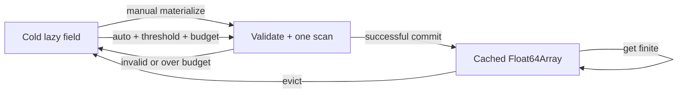

# Architecture and design decisions

## Data flow and lifetime

```mermaid
flowchart TD
  INP[INP UTF-8 text] --> SPANS[Section spans: O(file length)]
  SPANS -->|first ID query| INDEX[Per-section ID and row-offset index]
  INDEX --> LAZY[Lazy row/token decode]
  INDEX -->|materialize or auto hot field| SCAN[One-pass multi-column scanner]
  SCAN --> ARRAYS[Selected Float64Array columns]
  LAZY --> GET[properties.get]
  ARRAYS --> GET
  GET --> USER[Consumer]
  OUT[Binary OUT] --> HEAD[Header / trailer / metadata]
  HEAD --> RANDOM[Positioned I/O]
  RANDOM --> SERIES[Series, chunks, statistics, envelope]
```

`InpDocument.parse()` makes only a source-string reference and an index of section boundaries. No records are tokenized at open. On the first identifier lookup in a section, `locations()` builds a `Map<string, rowIndex|rowIndices>` and parallel `Uint32Array`s of byte offsets (actually UTF-16 **string offsets** in JavaScript) and line numbers. Those arrays are shared by the lazy and columnar paths. They are not duplicated when the cache is enabled.

`InpColumnStore` lives behind `InpProperties`. A column is a `Float64Array` indexed by document row position, matching `InpDocument.rowPosition`. A `Map<section, Map<field,Float64Array>>` routes named reads to these arrays. Raw source text remains the source of truth. No JSON objects are allocated per row to build the cache.

## Complexity / allocation model

Let **L** be source characters, **N** the records in the targeted section, **K** the count of newly materialized fields, and **Q** the number of later queries.

| Operation | Time (algorithmic) | Incremental allocation |
|---|---|---|
| `InpDocument.parse()` | O(L) | Section-span metadata only |
| First `get()` on an unindexed section | O(section characters) | ID Map and two packed offset/line arrays |
| Subsequent uncached `get()` | O(1) ID lookup + O(record width) lexer | Short-lived token array + value conversion |
| `materialize(section, K fields)` | O(section characters scanned up to farthest field) | `8 × N × K` bytes plus temporary state |
| Cached finite `get()` | O(1) ID lookup + array read | No per-row object/token array |
| `evict()` | O(cached columns selected) | Releases cache references; GC is asynchronous |
| `numericColumn()` | O(N) for standalone extraction or a cached-array copy | IDs and `8 × N` bytes |

The cache budget counts only owned typed-array payloads. It is **not** a process-level limit. For four fields over a million records, the payload is exactly 32,000,000 bytes (30.52 MiB). The document source, identifier map, indices, JS strings and runtime overhead are additional.

`forEachSelectedFields()` tokenizes only requested positions in a single pass. It supports comments, quoted IDs and multiple sections without creating per-record arrays. Its scratch field array is reused; internal code consumes it synchronously and never stores it.

## Cache state machine



- Default `mode:'lazy'` does not promote automatically, even when called repeatedly.
- `mode:'auto'` increments a counter for each **uncached successful numeric read**. It promotes after `max(minPromotionReads, ceil(N * promotionRatio))`. Default threshold parameters are 256 and 0.15. Thresholds are intentionally heuristics, not predictive latency optimizers.
- Auto currently promotes **one field at a time**. If the budget cannot fit it, lazy reads continue. The counter does not trigger a repeated expensive scan until eviction resets it.
- Manual materialization validates the complete field list and budget before scanning. It builds pending typed arrays off-cache and **only commits all fields when the scan succeeds**.
- Auto cannot cause an error from an unrelated bad input row to escape an otherwise valid `get()`. Such auto promotions are abandoned, while an explicit manual build still surfaces the input error.
- Cached NaN means absent token or `*`. Such values are resolved by a lazy fallback on `get()`, preserving its original result type.
- Eviction never alters `InpDocument`, and document edits create new instances; caches never follow edits across versions.

## Scope restrictions (intentional safety choice)

Many SWMM sections are not simple positional tables. For example, `OUTFALLS` changes offsets depending on FREE/FIXED/TIDAL/TIMESERIES, `LID_CONTROLS` stores multiple distinct parameter layers and `INFILTRATION` depends on model configuration. Blindly mapping offsets into fixed floating-point columns would return plausible but **incorrect** values. Version 0.5 therefore caches only fixed-layout numeric descriptors. Named lazy getters still cover supported variable layouts, and raw tokens preserve all data for future dialects.

**Full semantic columnar support for variants is future work** and must use a per-record schema resolver with explicit status masks for missing and literal `*`, not unsafe fixed positions.

## Why no automatic LRU?

For a very large section, one column build can be expensive. Evicting a deliberately materialized hot column merely because a different field has been queried risks repeated multi-megabyte parsing. Version 0.5 does not silently evict. It tracks exact payload bytes and leaves eviction under application control. A measured future adaptive cache could add LRU, hit-rate sampling and admission costs, but that requires representative field workloads first.

## Binary output design (unchanged in 0.5)

`.out` is time-major: the file stores each reporting period's timestamp and reported variables for all subcatchments, nodes, links and system totals. A random variable's byte offset is computed from its record type, object index, variable index, reporting period and stride. The library reads header/trailer first, then only requested positions. `seriesMany` batches requests to reduce I/O. Node file reads, browser Blob slicing and memory buffers use the same `ByteSource` abstraction. Streaming `seriesStatistics` and `seriesEnvelope` avoid allocating a full series for every operation.

The `.out` random-access strategy is distinct from the `.inp` numeric-column cache; no silent conversion to a different on-disk storage format occurs.


For the current batch OUT query API, see [QUERY-ENGINE.md](QUERY-ENGINE.md). Independent numerical verification remains an open requirement; see [VERIFY-NATIVE.md](VERIFY-NATIVE.md).


## Time-series index (not a server component)

An optional complete binary segment tree stores two Float32 extrema and two Uint32 source-period indices in each node. Construction streams a single selected `.out` series from OutReader; leaf values are preserved, including non-finite endpoint semantics, while interior extrema ignore non-finite samples. Indexed charts visit `O(maxPoints log(periods))` tree nodes instead of rescanning the source; no network/FS access is needed after build.

This component is deliberately **separate from OutReader** so most clients pay neither its build time nor its memory cost. It is also independent of persistence. Cache sidecars are created only when callers invoke `serialize()` and explicitly choose a destination. See [INDEX-FORMAT.md](INDEX-FORMAT.md) for the little-endian binary layout and identity contract.

## Multi-channel binary query engine

`OutReader.query()` reuses the existing variable-code and object-ID metadata, but returns a single compact series-major result buffer. Its cost planner evaluates sparse scalar reads, per-period coalesced groups and contiguous sequential reads. It constrains both maximum source-read size and over-read amplification; `queryStream()` additionally bounds result memory by yielding fixed-size chunks. `aggregateMany()` consumes those chunks and holds only O(number of requested channels) statistics.

The API/service layer is deliberately outside this package. See [QUERY-ENGINE.md](QUERY-ENGINE.md) for the physical layout, cost model, cancellation and byte-budget guarantees.
